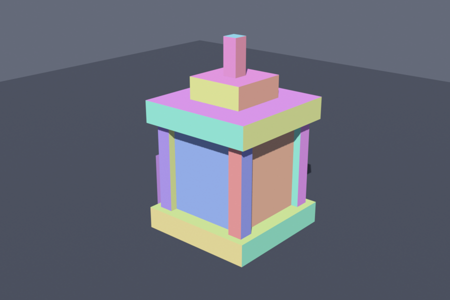
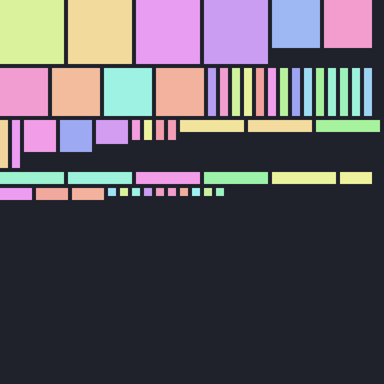

<h1 align="center">Hytale Blocky Model Exporter</h1>

<p align="center">
  <b>Model Hytale props and characters in Blender, from cubes and panes, and export them 1:1.</b><br>
  Boxes stay boxes, panes become quads, parents become nodes, and your UV layout survives the trip.<br>
  A Blender extension with no dependencies: only what ships with Blender.
</p>

<p align="center">
  
  
  
  
  <a href="https://github.com/Tasty-Syntax/Blender-Blockymodel-Exporter/actions/workflows/tests.yml"></a>
</p>

<p align="center">
  <a href="#install">Install</a> ·
  <a href="#quick-start">Quick start</a> ·
  <a href="#modelling-rules">Modelling rules</a> ·
  <a href="#the-export-panel">Export panel</a> ·
  <a href="#editable-uvs">Editable UVs</a> ·
  <a href="#pixel-grid-lock">Pixel grid lock</a> ·
  <a href="#development">Development</a>
</p>

<br>

<table>
  <tr>
    <td width="50%" valign="top">
      
      <br>
      <sub>A lantern built from nine boxes, wearing the placeholder texture made by <b>Generate UVs</b>.</sub>
    </td>
    <td width="50%" valign="top">
      
      <br>
      <sub>Its 96×96 texture, one pastel island per face, ready to rearrange in the UV Editor.
      The empty space below is what <b>Fit Texture</b> is for.</sub>
    </td>
  </tr>
</table>

<br>

<table>
  <tr>
    <td width="25%" valign="top">
      <h3>🧊 Exact, not approximated</h3>
      Every box and pane is exported as itself, with its exact position, rotation and size. No mesh cutting, no guessing.
    </td>
    <td width="25%" valign="top">
      <h3>🎨 UVs you control</h3>
      Generate a layout, then move, turn and mirror islands in Blender's UV Editor. The export reads them back.
    </td>
    <td width="25%" valign="top">
      <h3>📐 Pixel perfect</h3>
      Snap sizes to whole pixels at 32 or 64 px per block, so every face lines up with the texture grid.
    </td>
    <td width="25%" valign="top">
      <h3>🖌️ Ready to paint</h3>
      A placeholder PNG with every island in its own pastel color, the same on every export.
    </td>
  </tr>
</table>

## Install

1. Download `hytale_blockymodel_exporter-1.1.0.zip` from the
   [latest release](https://github.com/Tasty-Syntax/Blender-Blockymodel-Exporter/releases/latest).
2. In Blender: **Edit → Preferences → Get Extensions**.
3. Top-right **⌄** menu → **Install from Disk…** and pick the zip.

Requires **Blender 5.2 LTS** (tested with 5.2.3). The zip is built by the **Build extension**
workflow and attached to every release.

## Quick start

1. Model with cubes and panes: **1 Blender unit (m) = 1 block**.
2. Open the **Hytale** tab in the 3D Viewport sidebar (**N**).
3. Pick a **Format** in **Pixel Grid Lock**: Prop (32 px/block) or Character (64 px/block).
4. In **Export**, choose a **Collection** (or leave it empty to export the selection) and a **File**.
5. Click **Export**. You get `<name>.blockymodel` and a placeholder `<name>.png` next to it.

> [!TIP]
> Want to arrange the texture yourself? Set **UVs** to **From UV Map** and click
> **Generate UVs** before exporting. See [Editable UVs](#editable-uvs).

## Modelling rules

| | Rule |
|---|---|
| 📏 **Scale** | 1 Blender unit (m) = 1 block. A 1×1×1 cube becomes a 32³ box as a prop, or 64³ as a character. |
| 🧊 **Cube** | Any box (cuboid). Becomes a Hytale `box`. |
| ▭ **Pane** | A flat rectangle, like a Plane. Becomes a Hytale `quad`; its face normal decides which way it faces. |
| 🔄 **Transforms** | Move, rotate and scale in **Object Mode**. A box rotated in Edit Mode still exports as a box, but a piece that is no clean box is exported as its bounding box, with a warning. |
| 🧩 **Joined meshes** | One element per object, or join several (Ctrl+J): each separate piece becomes its own element. |
| 🌳 **Hierarchy** | Parenting is kept: parented objects become nested nodes, the object origin is the pivot. Empties work as pivots and groups. Collections become group nodes. |
| 🔢 **Pixel sizes** | Keep sizes whole pixels (multiples of 1/32 m for props) so UVs line up with the texture. The exporter warns otherwise. |
| 🚧 **Limit** | Hytale allows at most 255 nodes per model. |

**Axes:** Blender (X, Y, Z), Z-up → Hytale (X, Z, −Y), Y-up. Blender's front view (−Y) is
Hytale's front (+Z).

## The Export panel

Everything lives in the **Hytale** tab of the 3D Viewport sidebar (**N**).

| Setting | What it does |
|---|---|
| **Collection** | The collection to export, with its child collections as groups. Empty = the selected objects. |
| **UVs** | **Generate at Export** packs the faces automatically each time. **From UV Map** uses the layout you arranged ([Editable UVs](#editable-uvs)). |
| **File** | Full path of the `.blockymodel` file. Type it or use the browse button; `.blockymodel` is added if you leave it off. |
| **Export Texture** | On by default: writes the placeholder `<name>.png`. Turn it off to keep a texture you paint yourself; an existing PNG then never blocks the export. |
| **Overwrite Existing** | Off by default. When off, an existing model or texture stops the export with an error. |
| **Overwrite Texture** | Needs Overwrite Existing and Export Texture. When off, an existing `<name>.png` is kept and only the model is replaced. |
| **Export** | Writes the files and shows the full path. |

The format (Prop or Character) comes from **Format** in the Pixel Grid Lock panel.

<details>
<summary><b>Exporting from the File menu</b></summary>
<br>

**File → Export → Hytale Blocky Model (.blockymodel)**, or add it under
**Collection Properties → Exporters**. This opens the full export options: Collection, Format,
Apply Modifiers, Double-Sided Panes, UVs, Texture Size, Per-Face UVs and Island Padding.

With **Generate at Export**, the texture's width and height are multiples of 32 (or powers of
two).

</details>

## Editable UVs

By default the UVs are packed on every export. To lay them out yourself, set **UVs** to
**From UV Map** in the Export panel. Its options appear below the switch:

| Option | Default | |
|---|---|---|
| **Per-Face Islands** | on | One island per face instead of one box net per cube. |
| **Square Texture** | on | Makes the texture as tall as it is wide, so faces look square even in a UV Editor without the image. |
| **Island Padding** | 1 px | Empty pixels between islands. |
| **Texture Size** | Multiple of 32 | Round the texture to multiples of 32 or to powers of two. |

### The workflow

1. **Generate UVs** lays out every face of the export collection (or the selection) in a UV map
   named **Hytale**. It also creates the image **Hytale UV** with every island in its own pastel
   color, and shows it in the UV Editors of every workspace with **Pixel Round Mode** set to
   **Corner**, so moved UVs stay on whole pixels.
2. **Arrange** the islands in the UV Editor: move them, turn them in 90° steps (**R 90**) or
   mirror them (**S X -1** / **S Y -1**). **UV → Snap → Selected to Pixels** fixes UVs that drifted
   off the grid.
3. **Fit Texture** resizes the texture to the islands as they are now. Pack them tighter to save
   space, or move some past the edge to make room. Every island keeps its pixels and gets a fresh
   pastel color. It works from Edit Mode too.
4. **Export** as usual. The panel shows the current texture size.

> [!IMPORTANT]
> Hytale only stores where each face sits, how it is turned and whether it is mirrored, never
> its size. A face that is **stretched or scaled** in the UV Editor is exported at the top-left
> corner of its UVs, unturned, with a warning. Re-running **Generate UVs** replaces your
> arrangement.

<details>
<summary><b>Good to know</b></summary>
<br>

- Generate UVs reads the base mesh (no modifiers), so run it on the same objects you export, and
  add new pieces before generating.
- Generate UVs and Export use the same objects: every object in the export collection, including
  hidden ones and those in child collections, or the selection when the collection is empty.
- Objects without a **Hytale** UV map still export, with a warning.
- Linked duplicates (Alt+D) share one mesh, so they share UVs, laid out once.
- The back of a pane uses the same UVs as its front.
- A UV Editor that shows no image, or an image of another shape, makes faces look stretched.
  Pick **Hytale UV** in it.

</details>

## Pixel grid lock

Optional helpers in the **Pixel Grid Lock** panel to keep sizes on whole pixels:

| Setting | What it does |
|---|---|
| **Format** | 32 px/block for props, 64 for characters. Also sets the export format. |
| **Set Grid Snapping** | Turns on increment snapping at one pixel (1/32 m or 1/64 m). |
| **Lock Collection** | Only objects in this collection are snapped (empty = whole scene). Use it to leave reference geometry alone. |
| **Snap Now** | Rounds every box and pane side in the lock collection (or the selection) to whole pixels, and reports how many objects changed. |

> [!NOTE]
> Only sizes are snapped, not positions. The base mesh is changed (modifiers are not applied
> first), each side is scaled about the piece's centre, unclean pieces are skipped, and panes
> keep their flat side. A snap also changes every object that shares the mesh.

## Development

Source is in `modules/`, `__init__.py` registers it, and tests are in `tests/`.

```bash
# Pure-Python tests (mesh tests are skipped outside Blender)
python3 -m unittest discover -s tests -t .

# Full suite inside Blender
blender -b --factory-startup --python-exit-code 1 --python tests/run_in_blender.py

# Statement coverage of modules/
blender -b --factory-startup --python tests/measure_coverage.py
```

Replace `blender` with the path to your Blender binary. CI runs the full suite on Blender 5.2.3.

---

## License and credits

Licensed under [GPL-3.0-or-later](LICENSE). Copyright © 2026 TastySyntax.

Based on `export2blockymodel.py` from
[Blender-Hytale-Converter](https://github.com/MDufJokeAIR/Blender-Hytale-Converter) (MIT,
© 2017 lixinthu), simplified to a direct exporter. Its license is reproduced in
[THIRD_PARTY_LICENSES.md](THIRD_PARTY_LICENSES.md). The face and UV conventions follow the
official Hytale Blockbench plugin.

<sub>Hytale is a trademark of Hypixel Studios. This is an independent community project, not
affiliated with or endorsed by Hypixel Studios.</sub>
